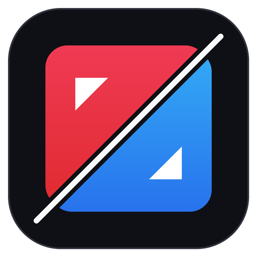
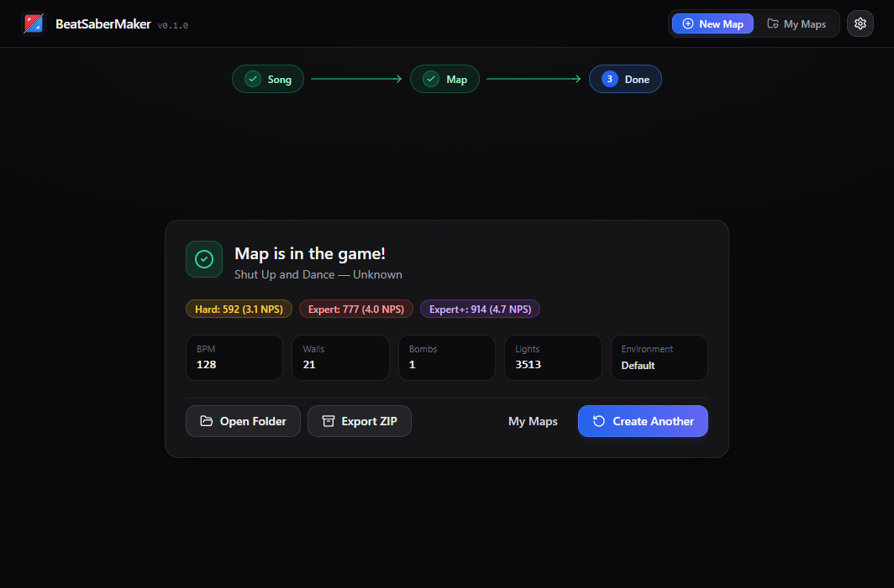
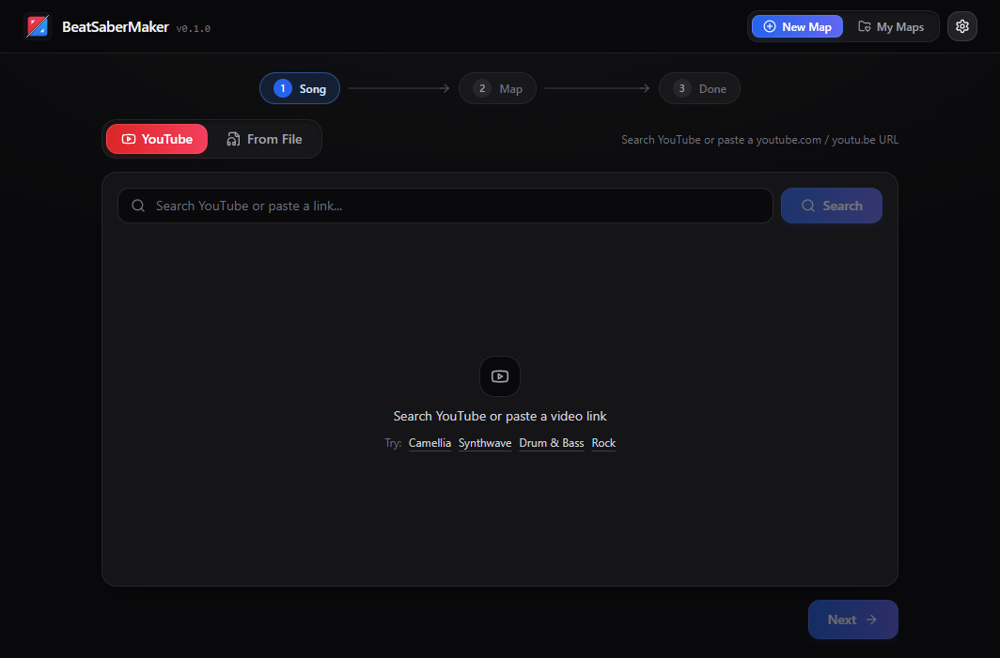
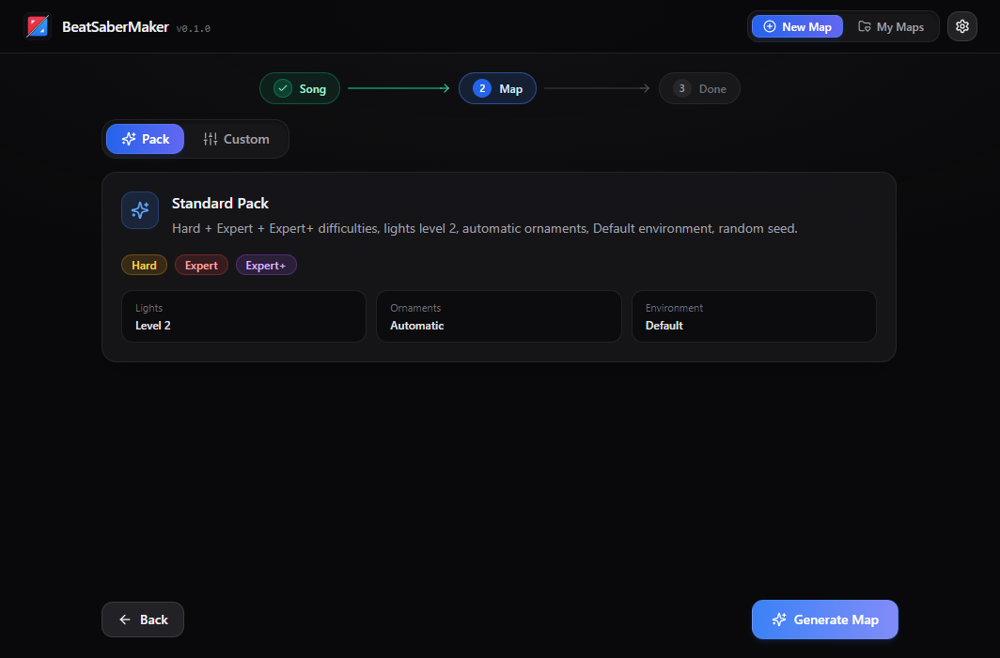
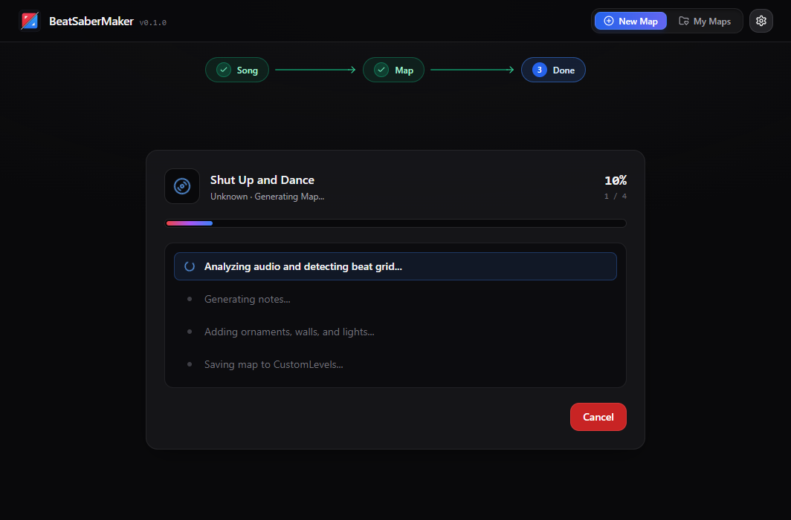
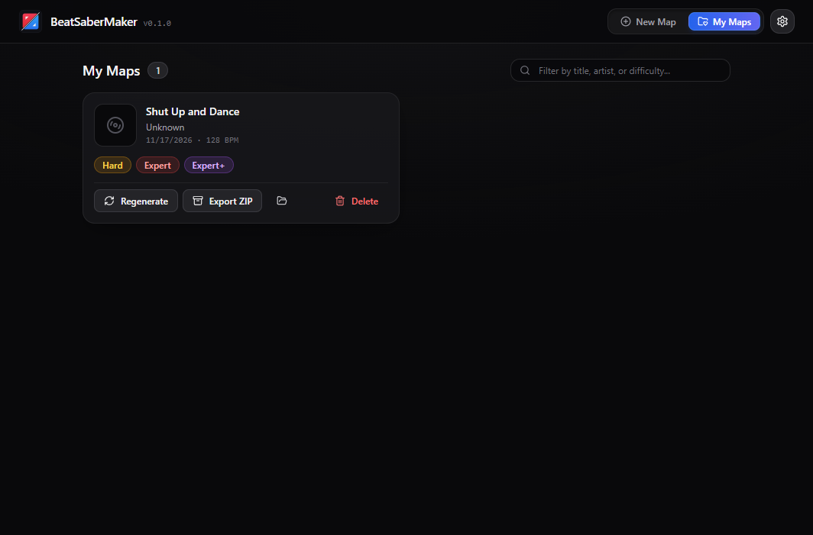

<div align="center">



# BeatSaberMaker

**Turn any song into a playable Beat Saber map, with notes, arcs, chains, walls, bombs and a full lightshow, in about a minute.**

[](https://github.com/al3ksh/BeatSaberMaker/releases/latest)


[**Download**](https://github.com/al3ksh/BeatSaberMaker/releases/latest) · [How it works](#how-it-works) · [Command line](#command-line) · [Building from source](#building-from-source)



</div>

---

## What it is

BeatSaberMaker is a desktop app that generates Beat Saber custom maps from music. You pick a song from YouTube or from your disk and choose how hard the map should be. The map is saved straight into your game's `CustomLevels` folder, ready to play.

The maps come from machine-learning models trained on curated community maps from [BeatSaver](https://beatsaver.com). A playability checker keeps out patterns that are unpleasant to play: bad parity, vision blocks, hand crossovers and impossible speeds.

## Features

- 🎵 **Any song.** Search YouTube or paste a link, or use an MP3, WAV, OGG, FLAC or M4A file.
- 🎯 **Real difficulty levels.** The default **Standard Pack** puts Hard, Expert and Expert+ in one map. **Custom** mode lets you pick the levels or an exact notes-per-second target, a map style and a seed.
- 🧠 **Two-stage note generation.** A timing model decides *when* notes go. A pattern model decides *which* notes they are (color, position, cut direction).
- ✨ **The rest of the map too.** Arcs and chains, decorative walls and bombs, and a lightshow. A neural model writes the lights, and a rule-based lightshow is available as an alternative.
- 🛡️ **Playable by construction.** Generated maps pass the built-in checker with zero hard violations.
- 📚 **My Maps library.** Search, regenerate with a new seed, export a `.zip` to share, open the folder, or delete a map (it goes to the Recycle Bin).
- 🔄 **Auto-updates.** The app updates itself from GitHub Releases.

<table>
  <tr>
    <td align="center"><br><sub><b>1. Pick a song</b> (YouTube or file)</sub></td>
    <td align="center"><br><sub><b>2. Choose the map</b> (pack or custom)</sub></td>
  </tr>
  <tr>
    <td align="center"><br><sub><b>3. Generate</b> (about 30–60 s on a GPU)</sub></td>
    <td align="center"><br><sub><b>4. Play, share, regenerate</b></sub></td>
  </tr>
</table>

## Download and install

1. Download **`BeatSaberMaker-Setup-0.1.0.exe`** from the [latest release](https://github.com/al3ksh/BeatSaberMaker/releases/latest) and run it.
   The installer is not code-signed yet, so Windows SmartScreen may show a warning. Click **More info → Run anyway**.
2. On first launch, click **Download Engine**. The app downloads the AI engine pack from the same release. The pack is about **5 GB** and contains PyTorch with CUDA, the trained models, ffmpeg and yt-dlp. Every part is checked with SHA-256, and an interrupted download resumes where it stopped.
3. Select your Beat Saber `CustomLevels` folder. The app fills it in when it can find the game.
4. Generate a map, start Beat Saber, and look for it under **Custom Levels** as `BSM - <song title>`.

**Requirements:** Windows 10 or 11 (x64) and about 10 GB of free disk space. An NVIDIA GPU is strongly recommended: a map takes about half a minute on an RTX card. Without one the engine runs on the CPU, which is much slower.

> BeatSaberMaker only writes, replaces or deletes the `BSM - …` folders it created itself. It never touches your other custom maps.

## How it works

```
song ─► decode + beat grid ─► timing model ─► pattern model ─► playability mask ─► layers ─► map folder
        (ffmpeg, librosa)     "when"          "which"         hard rules           │        Info.dat v2
                                                                                   │        difficulties v3.3
                                                        ornaments: arcs, chains ◄──┤
                                                        decor: walls, bombs     ◄──┤
                                                        lights: when + what     ◄──┘
```

- **Timing model.** Reads the song's mel spectrogram on a beat-aligned grid and predicts note onsets for the target density in notes per second.
- **Pattern model.** An autoregressive model over note tokens. For each onset it picks color, column, row and cut direction, based on the music and the notes before it.
- **Playability mask.** Hard rules are enforced during sampling, so bad notes are never generated in the first place. The rules cover swing parity, hand speed, vision blocks, same-cell collisions, crossovers and handclaps, and they were calibrated on human maps.
- **Layers.** Separate small models add ornaments (arcs and chains), decoration (walls and bombs) and lights for the Default environment. Each layer is checked against the notes so nothing collides.
- **Desktop app.** An Electron and React UI. It talks to a frozen Python engine (`bsmaker engine`, JSON lines over stdin and stdout), which ships as a separate versioned download.

## Command line

The app is a front end for the `bsmaker` CLI. You can also run the CLI directly from a source checkout:

```powershell
bsmaker generate "song.mp3" --levels hard,expert,expertplus   # a pack with 3 difficulties
bsmaker generate "song.mp3" --nps 4 --seed 2                  # one level at ~4 notes/s, a different variation
bsmaker check "BSM - song [nps 4, unknown]"                   # playability report
bsmaker preview "BSM - song [nps 4, unknown]" --out click.wav # the song with a click on every note
```

Main options for `generate`:

| Option | What it does |
|---|---|
| `--levels` | Comma-separated difficulties: `easy,normal,hard,expert,expertplus` |
| `--nps` | One difficulty at a target number of notes per second (0.5–12) |
| `--style` | Style tag; repeat it for several |
| `--ozdoby` | Ornaments and decoration level 0–3 (default: automatic from density) |
| `--swiatla` | Lights level 0–3 (default 2) |
| `--swiatla-reguly` | Use the rule-based lightshow instead of the model |
| `--tlo` | Environment name (default `Default`) |
| `--seed` | Generates a different map for the same song |
| `--out` | Output folder (default: your `CustomLevels`) |
| `--overwrite` | Replace an existing `BSM - …` map |

Training and evaluation (`bsmaker train …`, `bsmaker eval …`) need the dataset, which is not distributed. See [`docs/data-pipeline.md`](docs/data-pipeline.md) and [`docs/colab.md`](docs/colab.md).

## Building from source

**Engine (Python 3.13):**

```powershell
py -3.13 -m venv .venv
.venv\Scripts\python -m pip install torch --index-url https://download.pytorch.org/whl/cu128
.venv\Scripts\python -m pip install -e .
.venv\Scripts\python -m pytest -q
```

The trained checkpoints are not in git. [`docs/quickstart.md`](docs/quickstart.md) covers the full setup, including where the models go, and [`docs/environment.md`](docs/environment.md) describes the reference machine.

**App (Electron):**

```powershell
cd app
npm ci
npm run typecheck
npm test
npm run build
npx electron-builder --win --publish never
```

**Engine pack:** these scripts are in `packaging/`:
- `fetch_tools.py` downloads pinned, hash-checked ffmpeg (LGPL) and yt-dlp.
- `slim_checkpoints.py` prepares the trained checkpoints for shipping.
- `build_engine_pack.py` freezes the engine with PyInstaller, splits it into parts small enough for a release, and writes a manifest.

[`.github/workflows/release.yml`](.github/workflows/release.yml) runs the whole release pipeline. Version 0.1.0 was built locally with the same steps.

## Project layout

```
src/bsmaker/   Python engine: audio, map formats, models, playability, layers, generation, engine server, CLI
app/           Electron + React + Tailwind desktop app (electron/ = main process, src/ = UI, e2e/ = Playwright tests)
packaging/     PyInstaller spec and engine-pack build scripts
tests/         Python tests (pytest)
docs/          Quickstart, data pipeline, Colab training, design specs and plans
```

## Known issues in 0.1.0

- **Multi-difficulty packs get fewer walls and bombs than single-difficulty maps.** All difficulties share one decoration layer, and it is checked against the notes of every level, so a lot of it gets dropped.
- The installer and the engine are not code-signed, so SmartScreen shows a warning.
- Tested only on Windows 11 with an NVIDIA RTX GPU. CPU-only generation works but has not been benchmarked.
- There is no built-in map preview yet. To watch a map without a headset, export it as a ZIP and open it in [ArcViewer](https://allpoland.github.io/ArcViewer/). A built-in 3D viewer is in progress.

## Credits

- Training data: community maps from [BeatSaver](https://beatsaver.com). Thanks to every mapper whose work made this possible.
- Map format reference: the [BSMG wiki](https://bsmg.wiki).
- Built with [PyTorch](https://pytorch.org), [librosa](https://librosa.org), [Electron](https://www.electronjs.org), [React](https://react.dev), [Tailwind CSS](https://tailwindcss.com) and [Framer Motion](https://motion.dev).
- The engine pack includes [FFmpeg](https://ffmpeg.org), an LGPL build from [FFmpeg-Builds](https://github.com/FFmpeg-Builds/FFmpeg-Builds), and [yt-dlp](https://github.com/yt-dlp/yt-dlp), which is released under the Unlicense.

Beat Saber is a trademark of Beat Games. BeatSaberMaker is a fan project and is not affiliated with or endorsed by Beat Games or Meta. Only download and map music you have the right to use.

## License

Copyright © 2026 al3ksh. All rights reserved. The source code is public so you can read it and learn from it, but no license is granted to copy, modify or redistribute it.
